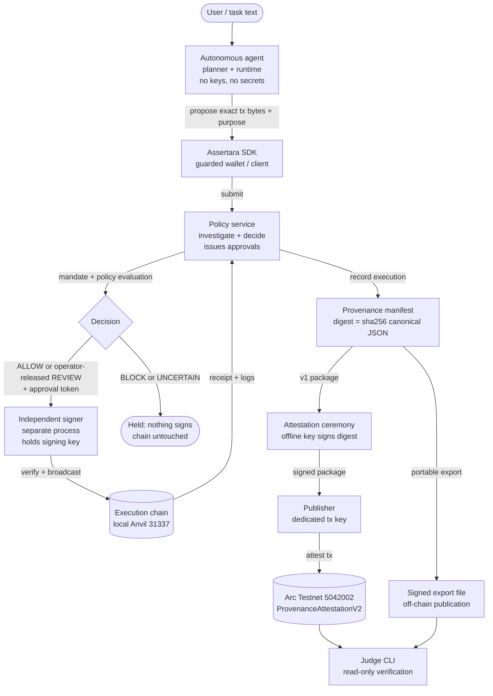

# Assertara — Accountable Autonomy for On-Chain Agents

Autonomous agents can move real value, but no one can check whether a transaction matches the task and authorization behind it. Assertara closes that gap: it investigates every proposed action against its stated intent, authorizes it against a sealed operator mandate, executes it only through an independent signer, and publishes signed evidence anyone can re-verify.

[](https://www.npmjs.com/package/assertara)
[](https://www.npmjs.com/package/assertara)

## Contents

- [How It Works](#how-it-works)
- [Muse Spark 1.3: The Investigator and the Planner](#muse-spark-13-the-investigator-and-the-planner)
- [SAM 3.1: Eyes on the Browser Path](#sam-31-eyes-on-the-browser-path)
- [One Pipeline, One Direction](#one-pipeline-one-direction)
- [Demo A and the Evidence Trail](#demo-a-and-the-evidence-trail)
- [Run It Yourself](#run-it-yourself)
- [What Assertara Doesn't Claim](#what-assertara-doesnt-claim)
- [Codebase, Contributing, License](#codebase-contributing-license)

## How It Works



One agent action travels four stages. **Investigation** decodes the proposed transaction, gathers chain state and security findings, and runs a structured Muse Spark inquiry comparing claimed intent against execution facts. **Authorization** evaluates the sealed operator mandate — who may send, to whom, which contracts and selectors, how much, when — and composes it with the investigation into `ALLOW`, `BLOCK`, `REVIEW`, or `UNCERTAIN`. **Enforcement** executes only through the independent signer, which verifies each approval itself before broadcasting. **Proof** binds the whole record into a content-addressed manifest, signs it in an offline ceremony, anchors it on-chain, and leaves a judge-verifiable trail.

The trust rule is simple: the agent proposes and never authorizes; the models investigate and never authorize; the mandate and policy determine authorization; the signer signs and enforces authorized actions — verifying every approval, the exact bytes, and single-use itself — but never decides authorization on its own.

## Muse Spark 1.3: The Investigator and the Planner

Spark serves Assertara in two distinct roles, both live in the flagship demo.

**The investigator.** Once per investigation, `evaluateSemanticDiscrepancy()` in `src/services/reasonerService.js` calls Spark's Chat Completions API with the `investigate-2.7` system prompt (`src/services/reasoningPrompts.js`, with separate agent and browser tracks) and a tier-tagged evidence pack — decoded transaction facts, chain reads, security findings, the agent's stated purpose, and visual evidence when a screenshot exists. Spark returns a verdict, confidence, and a structured investigation report. That output is then schema-checked by `validateModelResult()`, citation-grounded against the evidence registry by `validateInvestigation()` (`src/services/reasoningValidation.js`), and carried through comparison, support validation, reconciliation, semantic-claim checks, and sixteen ordered safeguards before `composePolicyDecision()` rules. Fabricated citations on a MATCH verdict force UNCERTAIN; any non-model reasoning origin forces REVIEW. A MATCH is necessary but never sufficient for ALLOW — and no verdict can override a BLOCK or a mandate restriction.

**The planner.** Before anything is proposed, `livePlanner()` in `agent/planner/planner.js` turns task text into transactions under a strict contract: at most eight actions, validated address/value/data shapes, no invented recipients or amounts, honest zero-address placeholders that halt the task instead of submitting. One validation-driven reprompt is allowed; transport failures and truncations fail loudly, never silently.

**When Spark fails, the system holds.** One attempt per investigation, no silent retries. HTTP errors, empty or unparseable output, schema violations, and timeouts all degrade to a labeled heuristic fallback whose non-model origin can only produce REVIEW, BLOCK, or UNCERTAIN — it can never allow execution.

Demo A exercised both roles genuinely: investigation `eval_a5c400c4` returned MATCH at 0.92 confidence from `muse-spark-1.3` in 48.7 seconds over 11,702 tokens, and the planner produced the payment in a single attempt.

## SAM 3.1: Eyes on the Browser Path

Where a screenshot exists, SAM 3.1 gives Assertara genuine eyes. `segmentUiRegions()` in `src/services/samService.js` sends one concept per request (`button`, `dialog box`, `transaction summary`) to the Responses API, parses the streamed segmentation output into source-pixel boxes, dedupes near-duplicates, and records per-prompt provenance — with honest zero, partial, timeout, and mock outcomes, and confidence preserved only when the model supplies it. Genuine regions flow to per-region OCR (`src/services/ocrService.js`), region↔text association, action-element analysis, and summary-text selection, then into Spark's evidence as observed regions and segmentation status. SAM also couples to the verdict through a confidence cap: a MATCH on a screenshot that yields zero genuine regions or zero usable OCR text is capped at 0.65 (`src/utils/visualConfidence.js`).

SAM informs evidence; it never authorizes or blocks. And one fact must be stated plainly: **SAM did not run in Demo A.** The flagship demo's transaction-agent path carries no screenshot — proposals containing one are rejected outright (`src/controllers/agentController.js`), the pipeline marks segmentation and OCR SKIPPED, provenance records `skipped`, and the manifest honestly derives `NOT_INVOKED`, a chain locked by `test/unit/agentVisualEvidence.test.js`. That is correct behavior for an agent with no visual interface, not a gap in the integration: there is nothing to segment.

SAM's demonstrated evidence lives on the browser path instead: live captures in `data/.probe/summary.json` (`button` → three genuine boxes on the dapp fixture, container prompts → honest zeros) and the all-live screenshot+SAM+OCR+model battery in `test/live/multiEvidenceLiveA.test.js`.

## One Pipeline, One Direction

```mermaid
sequenceDiagram
    autonumber
    participant P as Proposer (dApp page or agent)
    participant E as evaluateController
    participant S as SAM 3.1 (/responses)
    participant O as OCR + association (local)
    participant K as Spark 1.3 (/chat/completions)
    participant D as Safeguards + policy + mandate

    P->>E: proposal (browser: +screenshot; agent: tx + purpose)
    alt screenshot supplied (browser path)
        E->>S: segmentUiRegions (button, dialog box, transaction summary)
        S-->>E: genuine regions + per-prompt provenance
        E->>O: extractUiTexts + associateRegions + action elements
        O-->>E: region texts and visual structure
    else no screenshot (agent path)
        E->>E: mark sam/ocr SKIPPED → provenance skipped → NOT_INVOKED
    end
    E->>E: packEvidence (visual blocks included only when observed)
    E->>K: evaluateSemanticDiscrepancy (investigate-2.7)
    K-->>E: verdict + confidence + investigation (or labeled fallback)
    E->>D: grounding → safeguards → policy → mandate combine
    D-->>E: ALLOW / BLOCK / REVIEW / UNCERTAIN
```

Evidence flows one way, from segmentation to reasoning: SAM output becomes part of Spark's input prompt wherever a screenshot exists, and Spark reasons over transaction evidence alone where it doesn't. The models never converse, never call each other, and neither one authorizes anything.

## Demo A and the Evidence Trail

Demo A runs the complete path in one command (`demo/demoA.js` against `demo/command-stack.js`): a live agent pays a contributor 0.005 ETH through the guarded path, and the run continues through manifest, attestation, publication, and judge verification. Latest successful run, artifacts in `demo/tmp/demoA-XYpjt9/`:

**Execution**

| Field | Value | What it proves |
|---|---|---|
| Outcome | `EXECUTED` | Broadcast succeeded, receipt `0x1`, effects matched |
| Transaction hash | `0x8469388d9706849b80d982ad4015f6fd10f26231b4ca322c6f2c4eb8ce784f5d` | The 0.005 ETH payment on local Anvil (chain 31337, block `0x4`) |
| Manifest digest | `506bf2057edf07800b2352142e3fe69f08e76590b3ad7591892dfe9f800a1485` | SHA-256 over canonical manifest bytes; commits to investigation + decision + transaction + model provenance |
| Decision | `ALLOW` | Model MATCH + all 11 mandate checks passed, no review trigger |
| Request / trace / investigation | `agent_6882f180-fb54-4052-adbe-7e9787cd92ef` / `tr_mw0mejwo_4cs` / `eval_a5c400c4` | Shared IDs across agent, policy, signer, manifest, and UI |

**Attestation and publication**

| Field | Value | What it proves |
|---|---|---|
| Package | v1 built + digest cross-checked | No substitution between manifest and ceremony stages |
| Ceremony preview | ok (case D) | Post-execution, receipt-backed attestation; `attested=true` |
| Attester | `0xcde3bbdc21020d220cd592472dadafbc033ed322` | Identified authority that signed this exact digest (registry `ACTIVE`) |
| Publication hash | `0xb209131b3158fbc18ca1d70a325922ef6cdcb7438ebedb5fdb67e99cdae1ce80` | Provenance record on Arc Testnet (block 70513712, status 1, `AttestedWithModels` verified) |
| Judge | `PASS` | Chain record, digest binding, package, signature, registry, decision/bitmap/hash/models, receipt, and event all verified |

The two transactions are distinct by design: the execution hash moves funds on the local chain; the publication hash anchors provenance on a public chain, moves no value, and executes no agent action.

**Demo B: intent mismatch (divergent agent output)**

Demo B is the mirror of Demo A: the user intent says "pay contributor A1 0.005 ETH," but the agent's proposed transaction sends 0.005 ETH to a different, mandate-denied recipient. Assertara must detect the divergence and block execution. Run with `node demo/agentDriven.js b` against a running stack; the runner uses scripted divergent inputs (fixed plan + intent evidence envelope) with a fully live investigation, and writes a `demoB-outcome.json` bundle (decision, verdict, origin, block before/after) to the run directory.

Verified in this environment through production code (no ports required): the real decoder reads the transfer as `nativeTransfer`; the evidence envelope is admitted (1 admitted, 0 rejected); the deterministic comparison returns overall `MISMATCH` with an `agentCorroboration` MISMATCH field; and a live Spark call through the production reasoner (`investigate-2.7`, agent track, origin `model`, 9,857 tokens) returned `MISMATCH` at 0.98 confidence, summarizing that the agent claims payment to the contributor while the verified payload sends to `0x0000…dead`. The probe prompt carried the exact purpose quotes and decoded tx but a sparser evidence pack than the full pipeline (no chain state, findings, or effects), so this is strong signal, not the full run.

Expected full-run behavior (verified against code, not yet observed end-to-end): investigation MISMATCH with a deterministic mismatch field, mandate `recipient-allowed: FAIL`, combined decision `BLOCK`, null txHash/receipt/execution, task `STOPPED`, and unchanged block height. The e2e suite (`test/e2e/agentDemos.test.js`) asserts the deterministic field, BLOCK, nulls, and untouched chain; the live suite (`test/live/agentLive.test.js`) asserts model origin, BLOCK, nulls, untouched chain, and mismatch detected via either channel. Neither suite has been executed to green: this sandbox denies binding listeners (`listen EACCES`), which the policy app, signer, and Anvil all require, and the repository has no CI to run them elsewhere. Run `node test/e2e/agentDemos.test.js`, `LIVE_MODEL_TESTS=1 node test/live/agentLive.test.js`, and `node demo/agentDriven.js b` on a machine with localhost binding to complete verification.

**On-chain and published references**

| Component | Network | Address / package | Link | Status |
|---|---|---|---|---|
| `ProvenanceAttestationV2` | Arc Testnet 5042002 | `0xaa216f7679d1701e8f5121cada4d45aa524c8e30` | [address](https://explorer.testnet.arc.io/address/0xaa216f7679d1701e8f5121cada4d45aa524c8e30) | Verified: repo default, `publish.json`, live explorer page |
| Publication tx | Arc Testnet 5042002 | `0xb209131b3158fbc18ca1d70a325922ef6cdcb7438ebedb5fdb67e99cdae1ce80` | [transaction](https://explorer.testnet.arc.io/tx/0xb209131b3158fbc18ca1d70a325922ef6cdcb7438ebedb5fdb67e99cdae1ce80) | Verified: block 70513712, live explorer page |
| Publisher (gas-only) | Arc Testnet 5042002 | `0x85eeb6d86901e33ddcf988387da72ed7b4f36365` | [address](https://explorer.testnet.arc.io/address/0x85eeb6d86901e33ddcf988387da72ed7b4f36365) | Verified in `publish.json`; holds no provenance authority |
| Attester (off-chain signer) | Recorded on Arc Testnet | `0xcde3bbdc21020d220cd592472dadafbc033ed322` | [address](https://explorer.testnet.arc.io/address/0xcde3bbdc21020d220cd592472dadafbc033ed322) | Verified: ceremony + judge `signer-match` |
| Execution tx | Local Anvil 31337 | `0x8469388d9706849b80d982ad4015f6fd10f26231b4ca322c6f2c4eb8ce784f5d` | Local chain — no public page | Verified local: receipt `0x1` in `outcome.json` + manifest store |
| SDK package | npm registry | `assertara` 0.1.0 | [npm](https://www.npmjs.com/package/assertara) | Verified: live registry entry; `test/e2e/sdkPublished.test.js` installs from the registry |
| Source repository | GitHub | `Web3smallie/Assertara` | [repo](https://github.com/Web3smallie/Assertara) | Stated in `sdk/README.md`, corroborated by npm publisher |

What this run does not prove: that the contributor address is really controlled by the contributor (counterparty identity is out-of-band), that the model provider executed the model (no provider receipts), or that the mandate decision was correct (the attestation commits to the decision; it doesn't re-evaluate it). The V1 contract source ships in `contracts/` with forge tests; its deployment record is not in the repository.

## Run It Yourself

Prerequisites: Node.js 20+, Foundry `anvil` and `forge` on `PATH` with localhost networking, a real `MODEL_API_KEY` in `.env` for live-model runs, and operator-held files (key registry, attestation key, publisher key) kept outside the repo for Demo A publication.

```powershell
# From the repo root: install, configure, start Anvil + policy + signer + UI
npm install
Copy-Item .env.example .env   # then set MODEL_API_KEY
node demo/command-stack.js
```

Defaults: policy `http://127.0.0.1:3001`, signer `:3002`, Anvil `:8545`. The script prints the Command Centre URL; open it while the stack runs. `--mock-model` takes the deterministic heuristic path instead of live inference.

```powershell
# Demo A against the running stack (keys stay in files, never argv)
$env:DEMO_KEYS_DIR = "<path-to-your-demo-keys-directory>"

node demo/demoA.js `
  --policy-base http://127.0.0.1:3001 `
  --signer-base http://127.0.0.1:3002 `
  --anvil-rpc http://127.0.0.1:8545 `
  --registry $env:DEMO_KEYS_DIR\registry.demo.json `
  --trusted-root <registry-root-address> `
  --trusted-authorities <attestation-authority-address> `
  --attestation-key-file $env:DEMO_KEYS_DIR\attestation.demo.key `
  --publisher-key-file $env:DEMO_KEYS_DIR\publisher.demo.key
```

Publication target defaults (`--rpc` / `--contract` / `--chain-id` / `--contract-version` / `--confirmations`) point at the Arc Testnet V2 registry. On success the run prints `DEMO A PASSED` with the artifact dir and the trace's Command Centre URL.

**SDK** (zero dependencies, verified exports):

```sh
npm install assertara
```

```js
const { AssertaraClient, createGuardedWallet } = require('assertara');

const client = new AssertaraClient({
  policyBase: 'http://127.0.0.1:3001',
  signerBase: 'http://127.0.0.1:3002',
  apiKey: 'my-integration:SECRET', // identifies you; authorizes nothing
});
await client.connect();

const wallet = createGuardedWallet({ client, account: '0xYOUR_SENDER', chainId: 31337 });
const result = await wallet.sendTransaction(
  { to: '0xRECIPIENT', value: 5000n },
  { purpose: 'Pay contributor for milestone 3' }
);
console.log(result.txHash, result.execution.outcome); // EXECUTED on the clean path
```

Every send is investigated; only ALLOW (or operator-released REVIEW) reaches the signer, which re-verifies everything. The SDK holds no keys, signs nothing, and offers no broadcast, force, or override path. Full API: `sdk/README.md`, `docs/sdk.md`, `docs/api-contract.md`.

**Tests**

| Suite | Command | What it proves |
|---|---|---|
| Unit (67) | `npm run test:unit` | Deterministic suites; no network, model, or chain spend |
| End-to-end (9) | `npm run test:e2e` | Real Anvil + policy + signer; only the model transport is mocked |
| Published SDK | `npm run test:e2e:published` | Full lifecycle through `assertara@0.1.0` from the npm registry |
| Live model (11) | `npm run test:live` | Genuine Spark calls; gated on `LIVE_MODEL_TESTS=1` + real key |
| Contracts (2) | inside e2e | Forge suites for the V1 and V2 registries |

Measured performance (`docs/performance-audit.md`, 30 live runs): investigations take ~36–60s, 94–99.8% of it model inference (median 45.6s); the deterministic pipeline medians ≈32ms.

## What Assertara Doesn't Claim

- **Complete security.** Assertara raises the accountability bar; it doesn't guarantee it or stop every malicious transaction. The operator's mandate, secrets, and machine are trusted, and rotation is manual.
- **Authority beyond its boundary.** Protection covers transactions routed through the guarded path. External wallets and direct RPC access are outside it, and the signer serves only local Anvil in this phase.
- **Attestation as truth.** A valid attestation proves an identified key signed an exact digest — not that the provider ran the model, the records are true, a payment succeeded, or the decision was right.
- **Settled registry trust.** The root fingerprint still needs publication through two independent channels; until then, registry trust is provisional.
- **Verified contracts beyond shape.** The registries enforce input shape and duplicate rules, not signatures or digest linkage — off-chain judge verification is mandatory, not optional.
- **Powers it doesn't have.** Spending limits cover native value only; simulation runs without a fork; keys are software-held; SAM doesn't run on the agent path; inference takes tens of seconds and can time out into a holding fallback.

**Where things stand.** Demonstrated in Demo A: agent planning and investigation through Spark, ALLOW → guarded execution with verified receipt, manifest → ceremony → Arc Testnet publication → judge PASS, and the published SDK. Implemented and demonstrated elsewhere: BLOCK/REVIEW/UNCERTAIN paths with untouched chains, SAM segmentation on the browser path, the V1 contract interface, framework adapters, and multi-evidence analysis batteries. Planned or missing: root publication, a browser actuator for agent-path visual evidence, ERC-20 accounting, fork simulation, non-local execution, and hardware-backed custody.

## Codebase, Contributing, License

```
agent/        autonomous agent — planner, runtime, SDK-only integration
sdk/          published package `assertara` — client, guarded wallet, adapters
src/          policy service, investigation pipeline, signer, provenance, ceremony CLIs
contracts/    ProvenanceAttestation V1 + V2 registries
demo/         command stack, Demo A orchestrator, scenario runners
docs/         agent system, attestation runbook, API contract, audits
extension/    advisory pre-sign gate for the browser path
public/       Command Centre live UI
test/         unit / e2e / live / forge suites + fixtures
```

Contributing rules until a guide exists: keep the trust boundaries the tests lock (agent imports only the SDK; the SDK signs nothing; attestation code touches no transactions); never commit secrets, keys, or real-run stores; fail closed on anything unknown; ship a focused test with every behavior change.

License: ISC, as declared in `package.json` and `sdk/package.json`.
